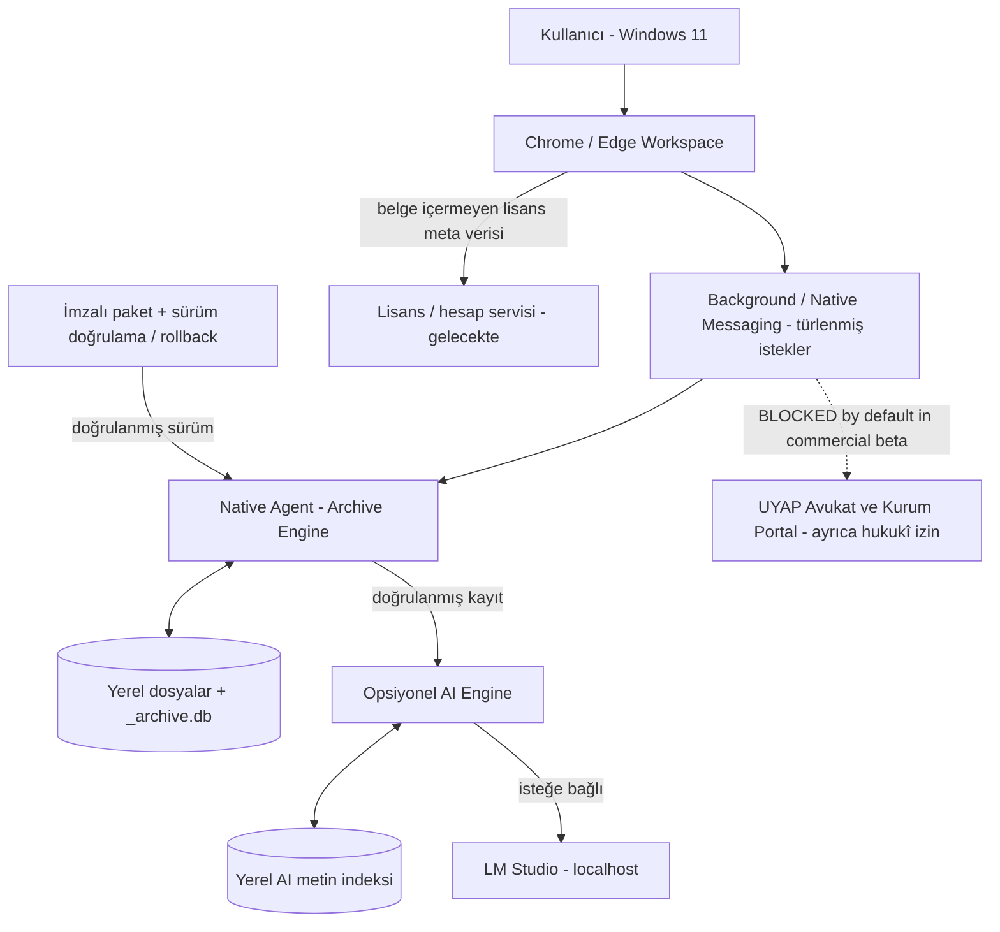

# S1-05 | Teknik Mimari Kararları (ADR) — Local-first Commercial Beta

**Tarih:** 15.10.2026  
**Durum:** TASLAK / teknik onay ve uygulama henüz yok.  
**Kapsam onayı:** DEC-S1-001 (yerel arşiv + isteğe bağlı ve ayrı kabul şartlı AI).  
**Hedef:** Windows 11 + Chrome/Edge, bireysel avukat ve küçük hukuk bürosu.  
**Dayanak sürüm:** `feature/ai-six-workflows` gözlenen `041dd9a`; ürün belgeleri `docs/sprint-01-productization` ve [S1-01](S1_PRODUCT_BRIEF.md) / [S1-02](S1_MVP_SCOPE.md) / [S1-03](S1_PORTAL_COMPLIANCE.md) / [S1-04](S1_DATA_PRIVACY_MAP.md).

> Bu ADR bir **mimari öneri ve karar izidir**; üretim bileşenlerinin uygulandığı, güvenlik denetimini geçtiği veya izin alındığı anlamına gelmez. Koddan teyit edilen mevcut özellikler ile uygulanması önerilen sınırlar ayrı belirtilmiştir.

## A. Mevcut ürün bileşenleri ve bağımlılıklar

| Katman | Kod / mevcut olgu | Kapsamı | Beta için karar |
| --- | --- | --- | --- |
| Extension UI | `manifest.json`, `workspace/`, `popup/` | Chrome MV3, Chrome/Edge UI ve görev yönetimi | Sürüm kimliği sabit; müşteri izin açıklaması, en az ayrıcalık incelemesi |
| Background/bridge | `background/service-worker.js`, `background/native-agent.js`, `content/` | Uzantı/portal/Native Messaging arasında olay akışı | Yerel arşiv işlemleri ile izin gerektiren portal otomasyonunu **yetki ve feature gate** üzerinden ayır (henüz uygulanması doğrulanmadı) |
| Archive Engine / Native Agent | `native/uyap_archive_agent.py`, `native/install_host.py` | Fiziksel evrak, SQLite, hash, registry, current/rollback | En temel ürün bağımlılığı; AI ve hesap olmadan da arşiv erişimi sürmeli |
| Archive storage | `UYAP_Arsiv` ve `_archive.db`; uzantının IndexedDB'si | Dava/evrak, fiziksel kanıt, UI durumları | “DB kaydı” ile “VERIFIED fiziksel içerik” ayrı; şema değişimleri geri uyumlu |
| AI Engine (opsiyonel) | `native/ai_local_index.py`, `native/ai_provider.py`, yerel çıkarım ve özet modülleri | Verified belge metninden analiz / SQLite AI indeksi | Kullanıcı açıkça etkinleştirmeli; unavailable ise çekirdek ürün çalışır |
| LM Studio / bulut AI | Localhost LM Studio ve kodda OpenAI API seçeneği | Opsiyonel model yanıtı | İlk beta yerel model tercih edilir; harici bulut AI ayrı hukukî/veri aktarımı kapısı geçmeden müşteri için kapalı |
| Hesap/Lisans | `account/account-config.js` içinde `enabled:false`; Supabase hazırlığı | Ticari yetki ve abonelik, ileride | Henüz ticari lisanslama yok; lisans sorgusu arşivi kilitleyemez |
| Installer & release | `native/build_offline_setup.ps1`, `native/install_host.py`, `config/release-*.json` | IExpress paket, Python runtime doğrulaması, registry, rollback, kanal kimliği | İmzalı beta dağıtımı ve gerçek Windows kabulü ayrı; prod otomatik updater yok |

### B. Hedef bileşen diyagramı



**Kritik bilgi:** Yukarıdaki `LIC`, `UPD` ve portal için `BLOCKED` kapıları **hedef tasarım**; diyagram yazılımda şimdiden uygulanmış olduklarının kanıtı değildir.

### C. Teknik sınır sözleşmeleri (ADR önerileri)

| ID | Sözleşme | Kabul kanıtı |
| --- | --- | --- |
| ADR-01 | Archive Engine AI'dan bağımsız çalışır. Local AI kapalı, model sunucusu yok, internet kapalı iken kullanıcı arşivini listeleyip dosyayı açabilir. | `BETA-CORE-06`, `BETA-AI-01` |
| ADR-02 | Native Agent yalnız tanımlı `action`/şema/oturum, izin verilen uzantı kaynağı ve vaka kapsamını kabul eder; yol, izin ve kaynak izolasyonu fail-closed. | Native Messaging yetki, kötü girdiler, provenance testleri |
| ADR-03 | Yerel Archive Engine yalnız kullanıcının açık seçimindeki belgeleri içe alır ve fiziksel hash ile doğrular; ispat yoksa VERIFIED statüsü yoktur. | E2E içe alma, eksik/değişmiş dosya |
| ADR-04 | AI yalnız fiziksel VERIFIED + kalitesi kabul edilmiş metin parçalarından beslenir; kaynak ve indeks kapsamı belirtilir. | Kapsam, çok dava izolasyonu, çapraz atıf ve model yanıtı doğrulama |
| ADR-05 | Ticari beta için portal otomatik indirme/tarama **özellik seviyesinde kapalıdır**; yalnız UX'te gizlemek yetmez, background ve native action yolları da reddeder. | İzin alınmamış beta profilinde otomasyon negatif testleri |
| ADR-06 | Lisans servisine hukuk evrakı, dava no, kişi adı, taranmış metin, dosya yolu, hash gönderilmez; yalnız asgari hesap/plan/cihaz lisans bilgisi tasarlanabilir. | Ağ kaydıyla lisans payload şema testi |
| ADR-07 | Lisans/abonelik/ağ hatası geçmişteki yerel arşivlere erişimi kilitlemez ve belgeyi silmez. Ticari ek özellik/premium AI ayrı yetkiyle kontrol edilebilir. | Lisans offline/expiry testleri + veri bütünlüğü |
| ADR-08 | İmzalı paket, onaylı dosya allowlist'i, sürüm matrisi ve doğrulanmış Authenticode ile sunulur. Unsigned-dev bayrakları müşteriye gitmez. | Kurulum paketi envanteri / imza denetimi |
| ADR-09 | Güncelleme önce kimlik/sürüm/şema ve imzayı doğrular; kullanıcı verisi ayrı yerde tutulur, hatada önceki current geri yüklenir. | Upgrade/rollback/fault injection |
| ADR-10 | Loglarda gerçek kişi/dava bilgisi varsayılan bulunmaz; destek dışa aktarımı maskelenmiş ve kullanıcı başlatmalıdır. | Synthetic PII redaction + dışa aktarma kontrolü |

## D. Ürün modu ve yetki kapıları (önerilen; henüz kod kanıtı yok)

| Bileşen/işlem | local_beta | ai_opt_in | portal_integration_approved |
| --- | --- | --- | --- |
| Yerel arşiv içe alma / açma / doğrulama | ON | Bağımsız | Bağımsız |
| Yerel dosya arama / zaman çizelgesi | ON | Bağımsız | Bağımsız |
| Yerel AI indeks oluşturma | Kullanıcı seçimi | ON ise | Bağımsız |
| LM Studio yerel model | Varsayılan OFF | İsteğe bağlı ON | Bağımsız |
| Harici cloud AI | **OFF / veri aktarım incelemesi** | Tek başına açmaya yetmez | Bağımsız |
| UYAP/Kurum Portal otomatik toplu işlem | **OFF / BLOCKED** | Bağımsız | Yalnız ayrı hukukî ve teknik GO sonrası |
| Lisans / premium abonelik | Planlanıyor | AI plan kuralı olabilir | Portal izninin yerine geçmez |

**Önerilen mimari kontrol:** Tek sürümlü, imzalanmış beta policy manifest + local Native Agent enforcement + UI görünürlük uyumu. `local_beta` ve `portal_integration_approved` gibi değişkenler bugün kodda varmış gibi varsayılmaz. Gizli veya kullanıcı tarafından değiştirilebilen bir işaret ile portal izni kanıtlanmaz.

## E. Sürüm ve dağıtım kararı

### E1. Şu an kodda görülen sürümler

- Uzantı: `2.9.0 RC15.9.38`, Manifest V3.
- Native Agent: `2.7.68`, Native Messaging protocol `2`.
- IndexedDB: `uyap-profesyonel-arsiv-v1`, sürüm 6; veri şema geçişi ayrıca test edilmeli.
- `config/release-contract.json`: `rc/prod` kimliği; `config/release-channels.json` beta/stable kanalı için imza ister.
- `distributionCapabilities`: `automaticUpdaterImplemented=false`, `codeSigningPipelineImplemented=false`, `stagedRolloutBackendImplemented=false`.

### E2. Sürümler arası uyumluluk tablosu — tasarım

| Component | Dev alpha | Beta adayı | Ticari stable |
| --- | --- | --- | --- |
| Extension | Unpacked / yalnız geliştirme | Beta kimliği ve dağıtım kanalı sabit | Mağaza veya doğrulanmış kontrollü dağıtım |
| Native Agent | Unsigned-dev yalnız test ortamı | İmzalı ve tarayıcıdan izinli | İmzalı + rollback kanıtlı |
| Protocol | Versioned action schema | Extension–Agent sürüm sözleşmesi | Fail-closed eski/yeni uyumsuzluk ekranı |
| Archive/DB | Yedek test seti | Şema migration forward ve backup restore | Veri kaybı olmadan upgrade / rollback |
| Portal access | Geliştirme/testte de kullanım şartlarına tabi | Ticari beta BLOCKED | Yalnız ayrı izin/uygunluk sonrası |
| AI | Dev test | Opsiyonel, ayrı kabul | Kaynaklı ve uzman kabulünü geçmiş |

### E3. Windows 10 karar notu

Microsoft, Windows 10'un standart desteğini **14.10.2025**'te bitirmiştir. İlk ticari ana platform **desteklenen Windows 11** olmalıdır. Windows 10 için test matrisi korunur, ancak müşteri kullanımına açılması **ESU/güvenlik yaması statüsü ve ürün risk kararı** ile ayrıca belirlenir. Windows 10'da smoke PASS almak tek başına güvenlik desteği sağlandığı anlamına gelmez.

## F. İmza, paketleme, Host kimliği ve güncelleyici sınırları

**P0 bulgusu — geniş paket kopyası:** `native/build_offline_setup.ps1` şu an `$PackageRoot` altındaki öğeleri, hedef setup EXE haricinde, geniş kapsamlı `Copy-Item -Recurse` ile yük içine alır. Kaynak çalışma klasöründe `.git`, dosya taslakları, geliştirici testleri veya sır içeren yerel dosyalar varsa yanlışlıkla pakete girebilir. Bunun istisnası açık paket allowlist'i + temiz geçici build workspace + paket içeriği taraması olmalıdır. Mevcut hâli ticari dağıtım için **BLOCKED / düzeltilmesi ve kanıtlanması gerekli**.

**P0 imza:** Üretim geliştirici özel anahtarı CI plaintext secret veya Git deposuna eklenmez; uygun imzalama servisi / güvenli anahtar yönetimi belirlenir. EXE, Native Agent ve bootstrap artefaktları için imza/üretici/manifest kontrolü tanımlanır. `--allow-unsigned-dev` yalnız geliştirmede kullanılabilir.

**Native Messaging:** `tr.gov.uyap.archive_agent` isimlendirmesi resmî kurumla ilişki izlenimi oluşturabileceği için ticari bağımsız isim seçimi + iki yönlü geçiş ve uninstall kararına bağlıdır. Kayıt anahtarı (HKCU Chrome/Edge, iki mimari görünümü), host manifest `allowed_origins` ve Chrome/Edge uzantı kimliği tam eşleşmeli; wildcard yok. Mevcut kullanıcılara veri kaybettirmeden migrasyon testi gerekir.

**Güncellemeler:** Hedefte update manifest imzalı/kanıtlı + checksum, N-1→N geçiş, hatalı N sürümünü reddetme, anlık geri alma ve SQLite sürüm uyumluluk politikası; otomatik updater yazılmış varsayılmıyor. Başlangıç olarak **manuel imzalı güncelleme** kabul edilebilir, ancak güvenlik ve destek akışı tasarlanmalıdır.

**Kaldırma:** Yazılımı kaldırmak arşiv evrakı, AI indeks ve özetleri varsayılan olarak silmez. Kullanıcı isteğine bağlı ayrı, geri dönüşü tanımlı veri silme akışı gerekir.

## G. Lisanslama için minimum veri modeli (öneri; henüz uygulanmadı)

```text
LicenseEntitlement {
  license_id: random opaque id
  plan_id: starter | professional
  seat_limit: integer
  expiration_at: timestamp or null
  client_device_id: rotateable pseudonymous ID
  signed_entitlement: signed blob
}
```

- Lisans API yalnız hesap/plan/cihaz doğrulaması; tüm belge ve dava verileri yerelde.
- İnternet yoksa daha önce doğrulanmış entitlement'ın süreli offline çalışması tartışılabilir; **yerel arşiv erişimi hiçbir lisans hatasıyla kaybedilmez**.
- Ticari sözleşme ve faturalandırma kimlikleri için ayrıca KVKK/açık metin ve veri silme politikası; kullanıcıyı e-posta zorunlu olmadan pilotta başlatma seçeneği incelenebilir.
- 7 günlük `offlineGraceDays` şu an yalnız devre dışı account config alanıdır; mevcut lisans koruması var diye sunulmaz.

## H. Güvenlik ve gizlilik incelemesi

- AI yerel indeksi, SQLite FTS ve kaydedilmiş sonuçların `_ai` / `%LOCALAPPDATA%\UYAPArsiv\AI_Summaries` dizinleri gerçek kişisel veri barındırabilir.
- `native/uyap_archive_agent.py` tanı JSON'unda `providerOutputPreview` gibi model yanıtı parçaları tutulabilir. Bu destek paketi maskeleme P0 konusudur (#6).
- Bulut AI `store:false` göndermesi saklama/aktarım yükümlülüklerini ortadan kaldırmaz; müşteri betasında hukukî/veri akışı kapısı gelmeden kapalı.
- UYAP/Kurum Portal kullanımı için S1-03 kararları saklıdır; “kullanıcı başlattı” demek portalın tüm otomasyonuna izin verildiği anlamına gelmez.

## I. Sprint 1 ADR karar listesi

| Karar kimliği | Karar / öneri | Durum | Sonraki adım |
| --- | --- | --- | --- |
| DEC-S1-001 | Yerel arşiv + opsiyonel AI | **ONAYLI** (ürün sahibi) | MVP teslim kabulü |
| ADR-01–04 | Local-first, Verified-only, AI opsiyonel | **ÖNERİ / teknik doğrulama bekliyor** | Kod modül sınırları ve negatif test |
| ADR-05 | Ticari betada portal otomasyonu kapalı | **POLİTİKA BLOCKED / teknik enforce bekliyor** | Beta feature gate tasarla |
| ADR-06–07 | Lisans metadata-only, yerel arşive erişim kalıcı | **ÖNERİ** | Lisans PO C / güvenlik |
| ADR-08–09 | Paket allowlist / imza / versioned update / rollback | **P0 AÇIK** | Installer sprint + kabul testleri |
| ADR-10 | Destek tanısı veri minimizasyonu | **P0 AÇIK** | #6 ile eşleme |
| ADR-11 | Win11 birincil, Win10 conditional ESU | **ÖNERİ** | Destek politikası onayı |
| ADR-12 | Ticari marka ve host isim geçişi | **AÇIK** | Marka + göç planı |

**ADR kapanış kapısı:** Ürün sorumlusu + teknik sorumlu, ADR-01–12'de açık kararları tek tek tarihli onaylar; P0'ların hangi Sprint 2 işlerine taşındığı netleşir; `S1_BETA_ACCEPTANCE.md` ile test izleri eşleşir. Bu dosyanın yazılması hiçbir özelliği otomatik devre dışı bırakmaz.

## J. Kaynaklar ve izlenebilirlik

**Depo:** [release-contract](https://github.com/BuseIbsiroglu0637/UYAP_ARCHIVE_AI/blob/feature/ai-six-workflows/config/release-contract.json), [release-channels](https://github.com/BuseIbsiroglu0637/UYAP_ARCHIVE_AI/blob/feature/ai-six-workflows/config/release-channels.json), [AI policy](https://github.com/BuseIbsiroglu0637/UYAP_ARCHIVE_AI/blob/feature/ai-six-workflows/config/ai-policy.json), [account config](https://github.com/BuseIbsiroglu0637/UYAP_ARCHIVE_AI/blob/feature/ai-six-workflows/account/account-config.js), [Native installer](https://github.com/BuseIbsiroglu0637/UYAP_ARCHIVE_AI/blob/feature/ai-six-workflows/native/install_host.py), [Offline setup builder](https://github.com/BuseIbsiroglu0637/UYAP_ARCHIVE_AI/blob/feature/ai-six-workflows/native/build_offline_setup.ps1), [installer acceptance](https://github.com/BuseIbsiroglu0637/UYAP_ARCHIVE_AI/blob/feature/ai-six-workflows/docs/WINDOWS_INSTALLER_ACCEPTANCE.md).

**Dış kaynaklar (15.10.2026):** [Microsoft Windows 10 End of Support](https://support.microsoft.com/en-us/windows/deployment/updates-lifecycle/windows-10-support-has-ended-on-october-14-2025), [Google Chrome Native Messaging](https://developer.chrome.com/docs/extensions/develop/concepts/native-messaging).

**İlişkili işler:** [#2 Core Certification](../../issues/2), [#3 Product Foundation](../../issues/3), [#4 Windows Installer](../../issues/4), [#6 Diagnostic redaction](../../issues/6), [#9 PDF quality](../../issues/9). AI'ye ilişkin [taslak PR #10](../../pull/10) dokümantasyon onayından bağımsızdır.
